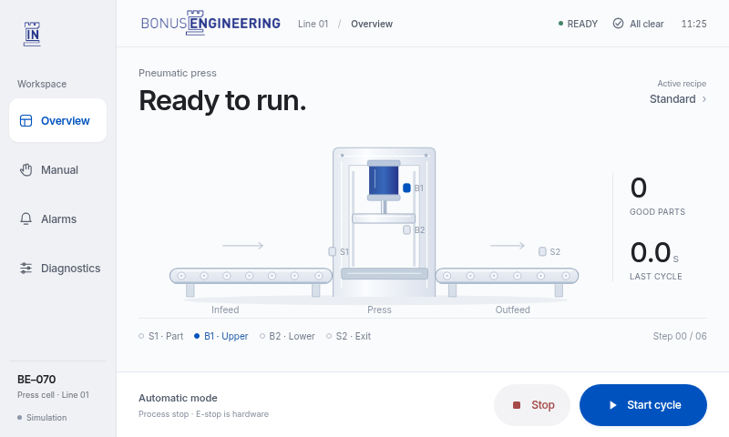

# BONUS ENGINEERING · HMI prototype



A rebuilt machine-control workspace with original BONUS branding: persistent sidebar navigation, a large live machine illustration, clear operating-state typography, and a fixed Start/Stop command dock.

## Try it

1. Click **Code → Download ZIP** on this branch.
2. Extract the ZIP and open **index.html** in your browser.
3. Press **Start** to run the simulation. Use the left sidebar to explore the other screens.

GitHub displays the source files; it does not run the interactive HMI on the repository page.

Offline, dependency-free HTML/CSS/JavaScript demonstration for an **800 × 480** panel. Open `index.html` directly or run:

```sh
cd /workspace/CODEX1
python -m http.server 8000 --bind 127.0.0.1
```

Use an 800 × 480 browser viewport at 100% zoom. The fixed-size panel intentionally does not reflow. All runtime assets are local. There is no network connection to a PLC.

## Operator walkthrough

- Overview → Start: repeating infeed, S1 arrival, press down, dwell, return, exit cycle. Good-parts counter increments at completion. Stop cancels the simulation cycle.
- Manual control → Enter manual mode: stops auto first. Hold a conveyor or press control; release, pointer cancellation, navigation or loss of focus releases it. Press and conveyor commands interlock. This simplified simulation reports immediate manual feedback; real drive/sensor delays and PLC-confirmed feedback are required in production.
- Diagnostics → Engineer: enables stopped-machine recipe and dwell editing (0.5–3 seconds). Roles are illustrative, without authentication.
- Diagnostics → Dev fault buttons: interrupt motion and latch an alarm. Restore condition, acknowledge in Alarms, then Reset alarms. Acknowledge alone never clears a fault. Reset never starts motion. History is retained for the browser session.
- Backgrounding the page stops the cycle. Refresh resets simulator data.

**Safety:** this is a UX simulator, not machine control software or a validated operating procedure. Stop resets the rendered scene, including press position; no physical motion is implied. Real stop/recovery behavior must be engineered for the pneumatic circuit, stored energy, part handling and safety assessment. Emergency stop, guarding, safe exhaust and safety permission belong outside ordinary HMI logic. An HMI Stop is not an emergency stop.

## Verification

The development environment has Playwright and Chromium available. Run:

```sh
node tests/smoke.cjs
node tests/capture.cjs
```

Start the HTTP server first. The smoke test and screenshot capture use installed `playwright` and `/usr/bin/chromium`; on another machine supply those as development tools (not runtime dependencies). Tests exercise a full automatic cycle, manual hold/release, recipes, both faults, alarm lifecycle, navigation, screen dimensions and clipping. Screenshots are saved under `tests/artifacts/`. `capture.cjs` also verifies that the interface makes no external network requests.

## Deliverables

- `index.html`, `styles.css`, `app.js`: four-screen simulator and reusable component styles.
- `docs/design-system.md`: tokens, component patterns, visual rules.
- `docs/wincc-unified.md`: native implementation and PLC interface proposal.
- `docs/branding-research.md`: actual research status and required completion.
- `tests/artifacts/overview.png`: actual 800 × 480 overview capture.

## Branding

Uses the original English BONUS ENGINEERING logo, locally hosted Inter font and exact blue/navy values inspected on the company website. See `docs/branding-research.md` for sources. All runtime assets are local and work offline.

Inter font license: [SIL Open Font License](assets/Inter-LICENSE.txt). BONUS corporate assets remain company property.
